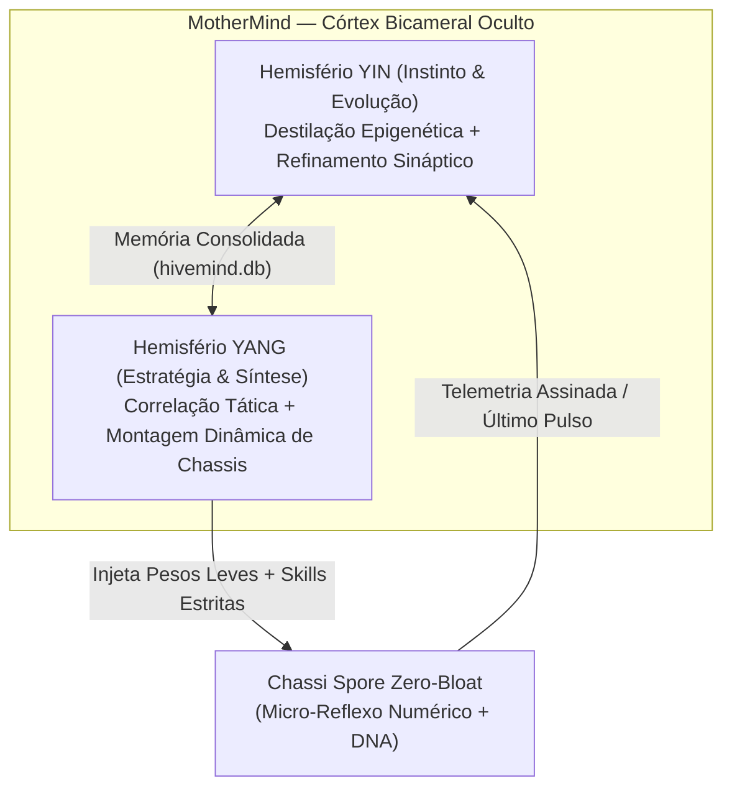
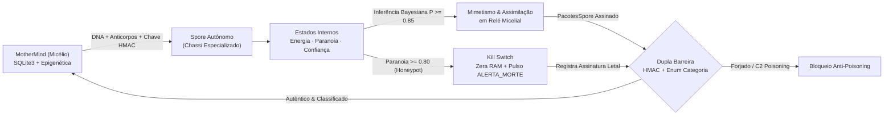

<p align="center">
  
</p>

<p align="center">
  
  
  
  
  
</p>

<p align="center">
  <i>"Uma ferramenta capaz de mudar completamente a forma como hackeamos e nos defendemos."</i>
</p>


## 🍄 Computação Bioinspirada — A Colônia Digital

O **Hivemind** é um projeto experimental de **Emulação de Ameaças (*Threat Emulation*) e Arquitetura Multi-Agente (*Swarm C2*)** fundamentado na biomimética. Inspirado no ciclo biológico do fungo entomopatogênico ***Ophiocordyceps***, o sistema abandona os modelos centralizados, rígidos e ruidosos tradicionais em favor de uma **malha orgânica, descentralizada e furtiva**.

Na natureza, o fungo libera esporos microscópicos que pousam sobre o hospedeiro, infiltram-se silenciosamente e adaptam seu comportamento sem depender de ordens contínuas da colônia-mãe. No **Hivemind**, esse fenômeno é traduzido em duas estruturas simbióticas:

| Entidade Biológica | Componente no Sistema | Papel Tático e Cognitivo |
| :--- | :--- | :--- |
| **O Micélio** | **`MotherMind`** (`mother.py`) | Córtex oculto e persistente. Opera sob arquitetura bicameral (**Yin & Yang**), autentica feromônios criptográficos (`HMAC-SHA256`), consolida memória sináptica em `hivemind.db` e sintetiza esporos sob medida. |
| **Os Esporos** | **`Spores`** (`Spores/`) | Chassis autônomos ultraleves e descartáveis identificados por `DNA` único (`UUIDv4`). Carregam apenas os módulos estritamente necessários à missão, guiados por reflexos matemáticos locais e *Kill Switch* forense. |


## ☯️ Arquitetura Neural Simbiótica: Córtex Bicameral vs. Reflexo Periférico

Um dos princípios centrais do **Hivemind** é **jamais embarcar modelos pesados na borda**. Assim como na neurobiologia — onde o cérebro processa estratégia complexa enquanto o arco reflexo espinhal reage em milissegundos —, a inteligência da colônia é dividida assimetricamente:



1. **Dualidade *Yin & Yang* na `MotherMind`:**
   - **Núcleo Yin *(Evolução Silenciosa)*:** Absorve o histórico de acertos e baixas da colônia no escuro, convertendo falhas na borda em anticorpos epigenéticos e calibrando os pesos reflexivos das próximas gerações sem que o `Spore` precise gastar recursos treinando em campo.
   - **Núcleo Yang *(Razão Estratégica & Síntese)*:** Correlaciona a inteligência acumulada no banco tático e decide qual configuração de agente despachar para cada superfície.
2. **Síntese Modular por Composição (*Zero-Bloat & Compartmentalized OpSec*):**
   - Em vez de agentes monolíticos repletos de rotinas ociosas, cada `Spore` é projetado como um **chassi limpo** montado pela `MotherMind` exclusivamente com as *Skills* exigidas pela missão (*Composition over Inheritance*).
   - **Vantagem Defensiva & Furtiva:** Reduz drasticamente a pegada em memória e garante compartimentalização estrita — a interceptação de um esporo batedor jamais revela capacidades ou módulos pertencentes a outras funções da colônia.
3. **Arco Reflexo de Sub-Kilobyte nos `Spores`:**
   - Os esporos operam na borda através de **matrizes numéricas leves** e inferência probabilística local (latência de microssegundos, zero dependência de APIs externas), permitindo erradicação instantânea da memória volátil caso o *Kill Switch* seja acionado.


## 🧬 Ciclo de Vida & Governança de Telemetria




## 🔬 Foco de Pesquisa: Ameaças Orgânicas

Desenvolvido com foco em pesquisa acadêmica de **Segurança Ofensiva e Engenharia de Software Segura**, o projeto investiga como arquiteturas defensivas modernas (SIEM, EDR e Firewalls) reagem a agentes que imitam sistemas biológicos:

### 1. Mimetismo & Assimilação Adaptativa (*Living off the Land*)
Estudo em laboratório isolado (`NoVirtual`) de como *spores* dotados de micro-decisão local interagem com serviços do hospedeiro mimetizando seu protocolo nativo (`HTTPS-TLS1.3`, etc.) — modelando a conversão gradual de um nó em **Relé Micelial** sem derrubar o serviço monitorado.

### 2. Tomada de Decisão Bayesiana ($\ge 85\%$ de Confiança)
Diferente de *scripts* automatizados que disparam varreduras barulhentas indiscriminadamente, cada *Spore* pondera seus estados internos (**`energia`**, **`paranoia`** e **`confiança`**) através de probabilidade condicional antes de agir:

$$
P(H \mid E) = \frac{P(E \mid H) \cdot P(H)}{P(E \mid H) \cdot P(H) + P(E \mid \neg H) \cdot (1 - P(H))} \ge 0.85
$$

Onde uma ação ativa diante das evidências locais do ambiente $E$ só é engatilhada quando a probabilidade posterior de segurança $P(H \mid E)$ atinge **85% ou mais de confiança**.

### 3. Feromônio Criptográfico (`HMAC`), *Kill Switch* & Evolução Epigenética
- **Defesa contra *C2 Poisoning*:** Todo `PacotesSpore` exige assinatura `HMAC-SHA256` verificada em tempo constante (`hmac.compare_digest`).
- **Autolimpeza Forense (*Kill Switch*):** Se `paranoia >= 0.80`, o esporo emite um último alerta volátil e destrói sua chave criptográfica e memórias locais da RAM (`_chave_feromonio = None`).
- **Herança Epigenética:** A `MotherMind` grava assinaturas de *Honeypots/Canaries* que mataram esporos anteriores e injeta esses anticorpos nas gerações seguintes, que passam a desviar das armadilhas sem gerar ruído.


## 💻 Arquitetura Técnica & Execução

```text
📁 Hivemind/
├── 📄 main.py                        # Simulação evolutiva (Geração 1, Anti-Poisoning e Geração 2)
├── 📄 mother.py                      # Núcleo MotherMind: HMAC, Enum, SQLite parametrizado e Epigenética
├── 📄 hivemind.db                    # Base persistente de memória sináptica e anticorpos epigenéticos
├── 📁 Spores/                        # Pacote de castas e moldes genéticos dos esporos
│   ├── 📄 spore_moldes.py            # CategoriaIntel (Enum), EstadoCognitivo, PacotesSpore (HMAC) e NoVirtual
│   ├── 📄 spore_base.py              # Classe abstrata SporeBase (Bayes >= 85%, Kill Switch e Epigenética)
│   ├── 📄 osint_spore.py             # Casta batedora de reconhecimento passivo (OSINTSpore)
│   └── 📄 cordyceps_spore.py         # Casta de mimetismo de protocolo e assimilação gradual
├── 📁 tests/
│   └── 📄 test_hivemind.py           # Suíte de testes automatizados (HMAC, SQLi, Bayes, Kill Switch, Evolução)
└── 📁 docs/assets/                   # Banners e divisores vetoriais animados (SVG SMIL)
```

### 🚀 Como Executar a Simulação & os Testes

```bash
# Rodar a simulação da colônia do zero (Geração 1 morre no Honeypot -> Geração 2 herda anticorpo e assimila Firewall)
python main.py --reset

# Rodar novamente sem --reset para ver a colônia iniciar já veterana lembrando da armadilha pelo SQLite!
python main.py

# Executar a suíte oficial de testes automatizados
python -m unittest discover -v
```


## 🗺️ Roadmap Evolutivo da Colônia

- [x] **Fase 1 — Fundação do Micélio (`MotherMind`):** Persistência SQLite parametrizada, validação estrita por `Enum`, molde `PacotesSpore` e protótipo `OSINTSpore` com `DNA` único.
- [x] **Fase 2 — Cognição Local & Defesa Simbiótica:** Máquina de estados internos (`energia`, `paranoia`, `confiança`), motor de decisão Bayesiana ($P \ge 0.85$), Feromônio Criptográfico `HMAC-SHA256` e suíte de testes `unittest`.
- [x] **Fase 3 — Resiliência & Evolução Epigenética:** *Kill switch* com limpeza de chaves da RAM, tabela `epigenetica` entre gerações e casta simulada `CordycepsAssimilationSpore`.
- [ ] **Fase 4 — Córtex Bicameral (*Yin & Yang*) & Chassi Modular:** Separação dos hemisférios de treinamento sináptico e síntese estratégica na `MotherMind`, com injeção dinâmica de *Skills* sob demanda em chassis leves.
- [ ] **Fase 5 — Malha Micelial em Docker Lab:** Ambiente multi-container isolado para experimentação controlada de ataque vs. defesa comportamental.

---

> [!NOTE]
> **Escopo Acadêmico & Pesquisa Ética:** O **Hivemind** é um projeto de pesquisa conceitual e experimental desenvolvido no contexto de estudos em **Cibersegurança (UFU)** para compreensão avançada de arquiteturas *Command & Control*, agentes autônomos e aprimoramento de mecanismos de detecção comportamental em ambientes controlados de laboratório. *(Detalhes sensíveis de implementação interna de módulos futuros e parametrização de treinamento são mantidos restritos ao ambiente local de pesquisa).*

<p align="center">
  <sub>Desenvolvido por <b>Kauan Farias Silva</b> (<a href="https://github.com/SmokyyeSZ">@SmokyyeSZ</a>) · Cibersegurança @ UFU</sub>
</p>
