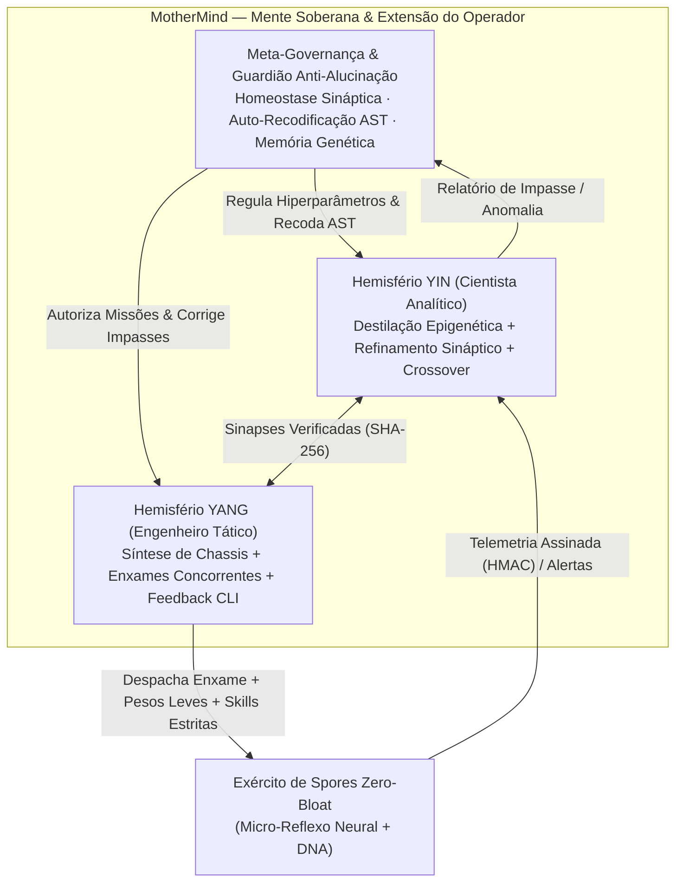
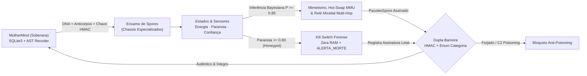

<p align="center">
  
</p>

<p align="center">
  
  
  
  
  
</p>

<p align="center">
  <i>"Uma ferramenta capaz de mudar completamente a forma como hackeamos e nos defendemos."</i>
</p>


## 🍄 Computação Bioinspirada — A Colônia Digital

O **Hivemind** é um projeto experimental de pesquisa científica em **Emulação de Ameaças (*Threat Emulation*), Computação Evolutiva e Arquitetura Multi-Agente (*Swarm C2*)** fundamentado na biomimética e desenvolvido de forma **100% soberana (*Air-Gapped*, sem dependência de APIs externas)**. Inspirado no ciclo biológico do fungo entomopatogênico ***Ophiocordyceps***, o sistema abandona modelos centralizados e rígidos em favor de uma **malha orgânica, auto-adaptativa e furtiva**.

Na natureza, o fungo libera esporos microscópicos que pousam sobre o hospedeiro, infiltram-se silenciosamente e adaptam seu comportamento sem depender de ordens contínuas. No **Hivemind**, esse ecossistema opera em três níveis hierárquicos simbióticos:

| Entidade Biológica | Componente no Sistema | Papel Tático, Meta-Cognitivo e Evolutivo |
| :--- | :--- | :--- |
| **A Mente Soberana** | **`MotherMind`** (`mother.py`) | Extensão cognitiva do operador humano. Supervisiona múltiplas colônias, governa os hemisférios *Yin & Yang*, intercepta anomalias epistêmicas (anti-alucinação), executa **auto-recodificação sintática via AST** e preserva a memória genética em `hivemind.db`. |
| **O Córtex Bicameral** | **Hemisférios *Yin & Yang*** | Dualidade operacional subordinada à `MotherMind`: o polo **Yin** conduz a evolução matemática, síntese neural e destilação epigenética; o polo **Yang** orquestra a montagem modular de habilidades, enxames paralelos e aprendizado autônomo de ferramentas por tentativa e erro. |
| **Os Esporos** | **`Spores`** (`Spores/`) | Chassis autônomos ultraleves e descartáveis identificados por `DNA` único (`UUIDv4`). Carregam exclusivamente os módulos necessários à missão, guiados por micro-reflexos neurais locais, inferência Bayesiana e *Kill Switch* forense. |


## 🧠 Hierarquia Cognitiva: `MotherMind` Soberana, Córtex Bicameral & Reflexo Periférico

Um dos princípios centrais do **Hivemind** é **jamais embarcar modelos pesados na borda**, mantendo simultaneamente uma governança central capaz de agir como extensão autônoma do pesquisador quando este não está presente:



1. **`MotherMind` como Meta-Controladora e Extensão do Operador:**
   - **Guardiã Epistêmica (Trava Anti-Alucinação):** Quando o córtex analítico encontra um impasse técnico real (como uma limitação sintática de ferramenta ou saturação de pesos neurais), o sistema é proibido de forjar ou simular falsos sucessos. Na ausência do operador humano, a `MotherMind` intercepta o diagnóstico, aplica regularização homeostática nas sinapses ou reescreve dinamicamente a árvore sintática abstrata (`AST`) do módulo afetado.
   - **Auto-Recodificação Auditável (*Self-Modifying AST Engine*):** Utilizando introspecção nativa do compilador Python, a `MotherMind` é capaz de analisar suas próprias rotinas e as habilidades dos agentes, sintetizar *patches* estruturais em memória, validar o *bytecode* resultante e registrar o *diff* criptograficamente assinado (`SHA-256`) no banco de dados para auditoria posterior do pesquisador.
   - **Orquestração Multi-Colônia:** Coordena enxames paralelos distribuídos em diferentes superfícies de teste, promovendo *Crossover Sináptico* entre os agentes sobreviventes de maior desempenho.
2. **Aprendizado Autônomo de Ferramentas (*Trial-and-Error Feedback Loop*):**
   - Para integrar ferramentas nativas de segurança e auditoria sem intervenção manual constante, o córtex executa um ciclo fechado no terminal: dispara a ferramenta em ambiente controlado, lê o fluxo de erro (`stderr`), bane argumentos inválidos, consulta autonomamente a documentação (`--help`) para extrair a gramática válida e encadeia a saída estruturada (`JSON`) entre múltiplas ferramentas.
3. **Síntese Modular por Composição (*Zero-Bloat & Compartmentalized OpSec*):**
   - Cada `Spore` é sintetizado como um **chassi limpo** contendo apenas as *Skills* exigidas pela missão, operando na borda com matrizes numéricas de sub-kilobyte ($\tanh(W \cdot \mathbf{x})$) e erradicação instantânea da memória RAM em caso de ativação do *Kill Switch*.


## 🧬 Ciclo de Vida, Governança Epistêmica & Evolução




## 🔬 Foco de Pesquisa: Ameaças Orgânicas & Resiliência de Baixo Nível

Desenvolvido com foco em pesquisa acadêmica de **Cibersegurança e Sistemas Inteligentes Evolutivos (UFU)**, o projeto investiga empiricamente:

### 1. Mimetismo, *Dynamic Software Updating (DSU)* & Relé Multi-Hop
Estudo em laboratório isolado de como agentes autônomos interagem com serviços de rede mimetizando protocolos nativos (`HTTPS-TLS1.3`, `gRPC-mTLS`), validando transições estritas de permissão de hardware na Unidade de Gerenciamento de Memória (**MMU $W \oplus X$: *Write XOR Execute***) com *rollback* atômico contra falhas de página e roteamento *Multi-Hop* em malha.

### 2. Tomada de Decisão Bayesiana ($\ge 85\%$) & Ativação Neural Local
Diferente de *scripts* ruidosos, cada *Spore* combina ativação neural reflexiva $\tanh(W \cdot \mathbf{x})$ com probabilidade condicional Bayesiana antes de realizar ações ativas:

$$
P(H \mid E) = \frac{P(E \mid H) \cdot P(H)}{P(E \mid H) \cdot P(H) + P(E \mid \neg H) \cdot (1 - P(H))} \ge 0.85
$$

### 3. Feromônio Criptográfico (`HMAC-SHA256`), *Kill Switch* & Epigenética
- **Defesa contra *C2 Poisoning*:** Todo `PacotesSpore` exige assinatura `HMAC-SHA256` verificada em tempo constante (`hmac.compare_digest`), além de verificação `SHA-256` de integridade para matrizes sinápticas persistidas.
- **Autolimpeza Forense (*Kill Switch*):** Se `paranoia >= 0.80`, o esporo emite um último pulso volátil e zera suas chaves criptográficas e pesos neurais da memória RAM.
- **Herança Epigenética & Crossover:** A `MotherMind` grava assinaturas de *Honeypots/Canaries* que neutralizaram esporos anteriores e injeta esses anticorpos nos enxames seguintes, combinando os pesos neurais dos melhores sobreviventes.


## 💻 Arquitetura Base do Repositório

```text
📁 Hivemind/
├── 📄 main.py                        # Orquestração evolutiva e bateria de experimentos da colônia
├── 📄 mother.py                      # Núcleo Soberano MotherMind: Meta-Governança, HMAC, SQLite, Epigenética e AST Recoder
├── 📄 hivemind.db                    # Base persistente de memória sináptica, integridade SHA-256 e auditoria evolutiva
├── 📁 Spores/                        # Pacote de castas, chassis neurais e moldes genéticos dos esporos
│   ├── 📄 spore_moldes.py            # CategoriaIntel (Enum), EstadoCognitivo, PacotesSpore (HMAC) e NoVirtual
│   ├── 📄 spore_base.py              # Classe base SporeBase (Bayes >= 85%, Kill Switch e Epigenética)
│   ├── 📄 osint_spore.py             # Casta batedora de reconhecimento passivo (OSINTSpore)
│   └── 📄 cordyceps_spore.py         # Casta de mimetismo de protocolo e assimilação gradual
├── 📁 tests/
│   └── 📄 test_hivemind.py           # Suíte oficial de testes automatizados e verificação epistêmica
└── 📁 docs/assets/                   # Banners e divisores vetoriais animados (SVG SMIL)
```

### 🚀 Como Executar a Simulação & os Testes

```bash
# Executar a bateria evolutiva da colônia
python main.py

# Executar a suíte oficial de testes automatizados
python -m unittest discover -v
```


## 🗺️ Roadmap Evolutivo da Colônia

- [x] **Fase 1 — Fundação do Micélio (`MotherMind`):** Persistência SQLite parametrizada, validação estrita por `Enum`, molde `PacotesSpore` e protótipo `OSINTSpore` com `DNA` único.
- [x] **Fase 2 — Cognição Local & Defesa Simbiótica:** Máquina de estados internos (`energia`, `paranoia`, `confiança`), motor de decisão Bayesiana ($P \ge 0.85$), Feromônio Criptográfico `HMAC-SHA256` e suíte de testes `unittest`.
- [x] **Fase 3 — Resiliência & Evolução Epigenética:** *Kill switch* com limpeza forense da RAM, tabela `epigenetica` entre gerações e casta `CordycepsAssimilationSpore`.
- [x] **Fase 4 — Córtex Bicameral (*Yin & Yang*), Enxame Paralelo & MMU $W \oplus X$:** Separação dos hemisférios de treinamento sináptico e síntese tática, despacho concorrente com *Crossover* e validação em hardware real.
- [x] **Fase 5 — `MotherMind` Soberana, Aprendizado CLI Autônomo & Auto-Recodificação AST:** Meta-governança anti-alucinação, domínio autônomo de ferramentas via terminal (`stderr` / `--help`) e auto-evolução sintática auditável.

---

> [!NOTE]
> **Escopo Acadêmico, Soberania & Pesquisa Ética:** O **Hivemind** é um projeto de pesquisa científica desenvolvido no contexto de estudos em **Cibersegurança (UFU)** para investigação de sistemas multi-agente autônomos, computação evolutiva e resiliência defensiva em ambientes de laboratório estritamente isolados (`127.0.0.1`). *(Detalhes sensíveis de implementação interna dos motores neurais, síntese de baixo nível e módulos de auto-recodificação são mantidos restritos ao ambiente local air-gapped de pesquisa).*

<p align="center">
  <sub>Desenvolvido por <b>Kauan Farias Silva</b> (<a href="https://github.com/SmokyyeSZ">@SmokyyeSZ</a>) · Cibersegurança @ UFU</sub>
</p>
