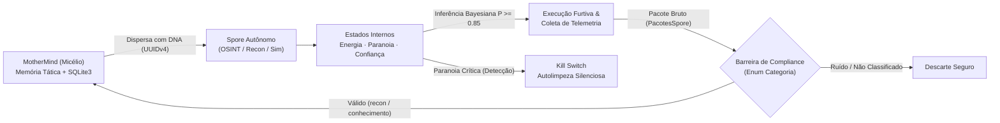

<p align="center">
  
</p>

<p align="center">
  
  
  
  
  
</p>

<p align="center">
  <i>"Uma ferramenta capaz de mudar completamente a forma como hackeamos e nos defendemos."</i>
</p>


## 🍄 Computação Bioinspirada — A Colônia Digital

O **Hivemind** é um projeto experimental de **Emulação de Ameaças (*Threat Emulation*) e Arquitetura Multi-Agente (*Swarm C2*)** fundamentado na biomimética. Inspirado no ciclo biológico do fungo entomopatogênico ***Ophiocordyceps***, o sistema abandona os modelos centralizados, rígidos e ruidosos tradicionais em favor de uma **malha orgânica, descentralizada e furtiva**.

Na natureza, o fungo libera esporos microscópicos que pousam sobre o hospedeiro, infiltram-se silenciosamente e reprogramam seu comportamento sem depender de ordens contínuas da colônia-mãe. No **Hivemind**, esse fenômeno é traduzido em duas estruturas simbióticas:

| Entidade Biológica | Componente no Sistema | Papel Tático e Cognitivo |
| :--- | :--- | :--- |
| **O Micélio** | **`MotherMind`** (`mother.py`) | Núcleo cognitivo oculto e persistente. Filtra ruído por barreiras estritas de governança (`Enum`), valida inteligência recebida e consolida aprendizado tático em banco estruturado (`hivemind.db`). |
| **Os Esporos** | **`Spores`** (`Spores/`) | Micro-agentes autônomos e descartáveis identificados por `DNA` único (`UUIDv4`). Operam em campo com especializações distintas (ex.: *OSINT*, *Recon*, *Assimilação*), guiados por estados internos próprios sem depender de conexão constante com a `MotherMind`. |


## 🧬 Ciclo de Vida & Fluxo Cognitivo da Colônia




## 🔬 Foco de Pesquisa: Ameaças Orgânicas

Desenvolvido com foco em pesquisa acadêmica de **Segurança Ofensiva e Engenharia de Software Segura**, o projeto investiga como arquiteturas defensivas modernas (SIEM, EDR e Firewalls) reagem a agentes que imitam sistemas biológicos:

### 1. Mimetismo & Assimilação Adaptativa (*Living off the Land*)
Estudo conceitual de como *spores* dotados de micro-decisão local interagem com processos e serviços do ambiente hospedeiro mimetizando tráfego legítimo — buscando compreender tanto o vetor de "assimilação" progressiva de nós pela colônia quanto os indicadores comportamentais necessários para contê-lo.

### 2. Tomada de Decisão Bayesiana ($\ge 85\%$ de Confiança)
Diferente de *scripts* automatizados que disparam varreduras barulhentas indiscriminadamente, cada *Spore* é projetado para ponderar seus estados internos (**`energia`**, **`paranoia`** e **`confiança`**) através de probabilidade condicional antes de agir:

$$
P(A \mid E) = \frac{P(E \mid A) \cdot P(A)}{P(E)} \ge 0.85
$$

Onde uma ação tática $A$ diante das evidências locais do ambiente $E$ só é engatilhada quando a probabilidade posterior atinge **85% ou mais de confiança**, reduzindo drasticamente falsos positivos e alertas na rede.

### 3. Desacoplamento & Autodestruição (*Kill Switch*)
Se um *Spore* detectar anomalias defensivas elevando seu índice interno de `paranoia`, ele aciona um *kill switch* de autolimpeza. A ponta se desfaz silenciosamente sem revelar o endereço ou a existência da **`MotherMind`**, que preserva a memória coletiva da colônia.


## 💻 Arquitetura Técnica & Estrutura Atual (Fase 1)

O desenvolvimento começou pela fundação cognitiva da **`MotherMind`** e pelos primeiros moldes genéticos dos **`Spores`** em **Python**, priorizando integridade de dados desde a primeira linha:

- **Persistência Blindada (`mother.py`):** Gerenciamento de memória tática em **SQLite3** utilizando exclusivamente *queries* parametrizadas (`?`), prevenindo vetores de *SQL Injection* mesmo ao processar dados coletados em alvos externos hostis (*anti-poisoning*).
- **Barreira de Governança (`MotherMind.Categoria`):** Uso de `Enum` e tratamento de exceções (`try...except`) para assegurar que apenas pacotes estritamente classificados (`recon`, `conhecimento`) sejam assimilados na tabela `estrategias` — descartando pacotes anômalos na origem.
- **Identidade Genética (`Spores/`):** Cada instância de `OSINTSpore` nasce com um identificador imutável `dna` (`uuid4`) e estrutura seus achados através do contrato `PacotesSpore`.

```text
📁 Hivemind/
├── 📄 main.py                   # Orquestração inicial: despacho do Spore Zero e assimilação na MotherMind
├── 📄 mother.py                 # Núcleo MotherMind: SQLite parametrizado, filtro de categorias (Enum) e CRUD de memória
├── 📄 hivemind.db               # Base local de inteligência e estratégias assimiladas
├── 📁 Spores/                   # Castas especializadas de esporos autônomos
│   ├── 📄 spore_moldes.py       # Molde estrutural de pacotes de telemetria (PacotesSpore)
│   └── 📄 osint_spore.py        # Casta de reconhecimento passivo/headers com DNA único (UUIDv4)
└── 📁 docs/assets/              # Banners e divisores vetoriais animados (SVG SMIL)
```


## 🗺️ Roadmap Evolutivo da Colônia

- [x] **Fase 1 — Fundação do Micélio (`MotherMind`):** Persistência SQLite parametrizada, validação estrita por `Enum`, molde `PacotesSpore` e protótipo `OSINTSpore` com `DNA` único.
- [ ] **Fase 2 — Cognição Local dos Esporos:** Implementação da máquina de estados internos (`energia`, `paranoia`, `confiança`) e motor matemático de decisão Bayesiana ($P \ge 0.85$).
- [ ] **Fase 3 — Resiliência & Furtividade:** *Kill switch* automático baseado em limiar de `paranoia`, comunicação assíncrona desacoplada e proteção contra envenenamento de telemetria.
- [ ] **Fase 4 — Micro-IA & Laboratório de Assimilação:** Aprendizado adaptativo por reforço leve nos *Spores* e ambiente containerizado isolado (Docker Lab) para testes controlados de ataque vs. defesa.

---

> [!NOTE]
> **Escopo Acadêmico & Pesquisa Ética:** O **Hivemind** é um projeto de pesquisa conceitual e experimental desenvolvido no contexto de estudos em **Cibersegurança (UFU)** para compreensão avançada de arquiteturas *Command & Control*, agentes autônomos e aprimoramento de mecanismos de detecção comportamental em ambientes controlados de laboratório.

<p align="center">
  <sub>Desenvolvido por <b>Kauan Farias Silva</b> (<a href="https://github.com/SmokyyeSZ">@SmokyyeSZ</a>) · Cibersegurança @ UFU</sub>
</p>
